# 💳 Normalización y Exploración de Transacciones Multifuente

> **AI for Developers Jr. · Kodigo El Salvador** · Actividad individual · Semana 5


Este sistema recibe transacciones financieras de **tres fuentes con estructuras distintas**:
una pasarela de pagos web, un archivo bancario y una terminal de punto de venta. Las **normaliza**
a un esquema común, las **valida** con reglas explícitas, calcula **métricas** y permite
**explorarlas** desde dos interfaces interactivas: una **CLI** y una **aplicación web**.

---

## 📑 Tabla de contenido

1. [Contexto de la actividad](#-contexto-de-la-actividad)
2. [Cumplimiento de requerimientos](#-cumplimiento-de-requerimientos)
3. [Inicio rápido](#-inicio-rápido)
4. [Arquitectura](#-arquitectura)
5. [Fuentes de datos soportadas](#-fuentes-de-datos-soportadas)
6. [Esquema normalizado](#-esquema-normalizado)
7. [Reglas de normalización](#-reglas-de-normalización)
8. [Validación y manejo de inválidas](#-validación-y-manejo-de-inválidas)
9. [Métricas](#-métricas)
10. [Interfaces](#-interfaces)
11. [Datos de prueba](#-datos-de-prueba)
12. [Pruebas automáticas](#-pruebas-automáticas)
13. [Cómo extender el sistema](#-cómo-extender-el-sistema)
14. [Uso de IA](#-uso-de-ia)
15. [Estructura del proyecto](#-estructura-del-proyecto)

---

## 🎯 Contexto de la actividad

**Objetivo:** evaluar la capacidad de normalizar datos heterogéneos, modelarlos correctamente
y exponerlos mediante una interfaz interactiva en Python, demostrando dominio técnico, criterio
de diseño y uso consciente de la IA como apoyo al desarrollo.

**El problema:** cada fuente representa la misma información de forma distinta. Por ejemplo,
un pago de **$25.99 aprobado** puede llegar así:

| Fuente | Cómo llega el monto | Cómo llega el estado | Cómo llega la fecha |
|---|---|---|---|
| Pasarela web | `2599` (centavos) | `"succeeded"` | `"2026-10-02T14:30:00Z"` |
| Banco | `"25,99"` (texto, coma decimal) | `"Aprobado"` | `"02/10/2026 08:30"` |
| Punto de venta | `25.99` (número) | `"00"` (código) | `1790951400` (epoch) |

El sistema convierte los tres casos en **un mismo registro** comparable y sumable.

---

## ✅ Cumplimiento de requerimientos

| Requerimiento | Implementación | Ubicación |
|---|---|---|
| Leer transacciones desde JSON | Acepta una lista `[...]` o un objeto `{"transacciones": [...]}` | [`src/procesador.py`](src/procesador.py) |
| Detectar el tipo o la fuente | Por campo `fuente` explícito o por la firma de claves | [`src/normalizador.py`](src/normalizador.py) |
| Normalizar a un formato común | `dataclass Transaccion` | [`src/modelo.py`](src/modelo.py) |
| Conversión de montos | Centavos, decimal y texto con formato local → `Decimal` con 2 decimales | [`src/normalizador.py`](src/normalizador.py) |
| Normalización de moneda | Alias (`$`, `Dólares`, `Q`, `€`…) → ISO-4217 | [`config/reglas.json`](config/reglas.json) |
| Mapeo de estados | Más de 30 valores de origen → 4 estados de negocio | [`config/reglas.json`](config/reglas.json) |
| Formatos de fecha | 9 formatos más epoch, convertidos a UTC-6 | [`config/reglas.json`](config/reglas.json) |
| Identificar inválidas y decidir qué hacer | 18 códigos de error; política `separar` / `marcar` / `descartar` | [`src/validador.py`](src/validador.py) |
| Métricas | Totales, válidas vs. inválidas, por estado, por moneda y por fuente | [`src/metricas.py`](src/metricas.py) |
| Interfaz interactiva (no solo prints) | CLI con menús, filtros y paginación, más una **web en Flask** | [`src/interfaz_cli.py`](src/interfaz_cli.py), [`src/interfaz_web.py`](src/interfaz_web.py) |
| Separación de responsabilidades | Un módulo por responsabilidad; las interfaces solo presentan | [`src/`](src/) |
| Archivo de reglas o configuración | Todo lo configurable vive fuera del código | [`config/reglas.json`](config/reglas.json) |
| Nota técnica (máx. 1 página) | Decisiones de diseño, uso de IA y ajustes | [`NOTA_TECNICA.docx`](NOTA_TECNICA.docx) · [`.md`](NOTA_TECNICA.md) |
| Datos de prueba válidos e inconsistentes | 12 válidos, 22 inconsistentes y 1 archivo mixto | [`data/`](data/) |

---

## 🚀 Inicio rápido

**Requisitos:** Python **3.10 o superior**. La CLI no necesita instalar nada.

```bash
# 1. Clonar o descargar el proyecto y entrar a la carpeta
cd semana5

# 2. Interfaz de consola (sin dependencias)
python main.py

# 3. Interfaz web (opcional)
pip install -r requirements.txt
python web.py            # → abrir http://127.0.0.1:5000

# 4. Pruebas automáticas
python -m unittest discover -s tests -t . -v
```

### Opciones de línea de comandos

```bash
python main.py data/datos_validos.json            # cargar otro archivo
python main.py --reglas otra_config.json          # usar otras reglas
python web.py data/datos_inconsistentes.json --puerto 8000
```

---

## 🏗️ Arquitectura

El flujo es un **pipeline lineal**. Cada etapa tiene una sola responsabilidad y **no conoce a
las interfaces**:

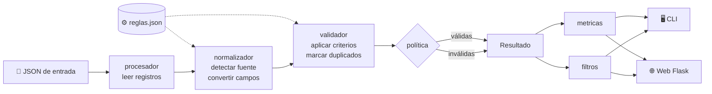

### Principios de diseño

| Principio | Cómo se aplica |
|---|---|
| **Reglas como datos** | Las monedas, los estados, los formatos de fecha, las fuentes y los criterios de validez están en `reglas.json`. Cambiar una regla **no requiere tocar el código**. |
| **Normalizar ≠ validar** | El normalizador **nunca descarta**: si no entiende un valor, deja `None` y agrega una nota. Solo el validador decide si la transacción es válida. |
| **Trazabilidad** | Cada transacción conserva su registro `original`, así cualquier transformación se puede auditar. |
| **Precisión monetaria** | Se usa `Decimal` y nunca `float`, para evitar errores de redondeo como `0.1 + 0.2 = 0.30000000000000004`. |
| **Interfaces intercambiables** | La CLI y la web comparten el 100 % de la lógica; solo difieren en la presentación. |

---

## 🔌 Fuentes de datos soportadas

| Fuente | Se detecta por | Monto | Fecha | Estado |
|---|---|---|---|---|
| `pasarela_web` | `txn_id` + `amount_cents` | Entero en **centavos** | ISO-8601 con zona (`Z`, `-06:00`) | Inglés: `succeeded`, `refunded`… |
| `banco` | `referencia` + `monto` | **Texto** local: `"1.234,56"`, `"Q 2.100,50"` | `dd/mm/aaaa [hh:mm[:ss]]`, `dd-mm-aaaa` | Español: `Aprobado`, `EN PROCESO`… |
| `pos_tienda` | `ticket` + `total` | **Decimal**: `12.5` o `"45.90"` | **Epoch** en segundos | Códigos: `00`, `05`, `51` |

**Algoritmo de detección:**

1. Si el registro trae un campo `"fuente"` con un nombre conocido, se usa ese.
2. Si no, se elige la primera fuente cuyas claves de `detectar_por` **existen** en el registro
   (aunque su valor sea `null`, para poder reportar `MONTO_FALTANTE` en lugar de una fuente
   desconocida).
3. Si ninguna coincide → `FUENTE_DESCONOCIDA`.

<details>
<summary><b>Ejemplo de un registro por fuente</b></summary>

```json
{"txn_id": "PW-1001", "amount_cents": 2599, "currency": "usd", "status": "succeeded",
 "created_at": "2026-10-02T14:30:00Z", "customer": {"email": "ana.lopez@correo.com"}}

{"referencia": "BN-55001", "monto": "1.250,75", "divisa": "Dólares", "estado": "Aprobado",
 "fecha_operacion": "03/10/2026 08:45", "titular": "María Hernández"}

{"ticket": "POS-9001", "total": 12.5, "moneda": "USD", "codigo_respuesta": "00",
 "timestamp": 1791040500, "terminal": "TERM-01", "sucursal": "San Salvador Centro"}
```
</details>

---

## 🧱 Esquema normalizado

Todas las fuentes terminan en esta estructura ([`src/modelo.py`](src/modelo.py)):

| Campo | Tipo | Descripción |
|---|---|---|
| `id` | `str` | Identificador de la transacción en su fuente |
| `fuente` | `str` | `pasarela_web` · `banco` · `pos_tienda` · `DESCONOCIDA` |
| `fecha` | `datetime` | Siempre con zona horaria, convertida a **America/El_Salvador (UTC-6)** |
| `monto` | `Decimal` | En **unidades** de la moneda (nunca centavos), con 2 decimales |
| `moneda` | `str` | Código **ISO-4217** en mayúscula |
| `estado` | `str` | `APROBADA` · `PENDIENTE` · `RECHAZADA` · `REEMBOLSADA` |
| `cliente` | `str?` | Correo, titular o terminal, según la fuente |
| `descripcion` | `str?` | Concepto, descripción o sucursal |
| `valida` | `bool` | Resultado de la validación |
| `errores` | `list[str]` | Códigos de error (vacía si es válida) |
| `original` | `dict` | Registro tal como llegó (trazabilidad) |
| `notas` | `list[str]` | Advertencias del proceso de normalización |

**Ejemplo de transformación:**

```text
ORIGINAL (banco)                              NORMALIZADO
─────────────────────────────────            ─────────────────────────────────────
"referencia": "BN-55003"                 →    "id": "BN-55003"
                                              "fuente": "banco"
"monto": "Q 2.100,50"                    →    "monto": "2100.50"
"divisa": "GTQ"                          →    "moneda": "GTQ"
"estado": "aprobada"                     →    "estado": "APROBADA"
"fecha_operacion": "18-10-2026"          →    "fecha": "2026-10-18T00:00:00-06:00"
"titular": "Distribuidora Maya"          →    "cliente": "Distribuidora Maya"
```

---

## ⚙️ Reglas de normalización

Todas están en [`config/reglas.json`](config/reglas.json), documentadas con claves `_comentario`.

### 💵 Montos

| `formato_monto` | Entrada | Proceso | Salida |
|---|---|---|---|
| `centavos` | `2599` | ÷ 100 | `25.99` |
| `decimal` | `"45.90"` / `12.5` | conversión directa | `45.90` / `12.50` |
| `texto` | `"Q 2.100,50"` | quitar símbolos → quitar el separador de miles `.` → cambiar la `,` decimal por `.` | `2100.50` |

Siempre se redondea a 2 decimales con `ROUND_HALF_UP`. Los booleanos y los valores no finitos
se rechazan.

### 💱 Monedas

- **Soportadas:** `USD`, `EUR`, `GTQ`, `MXN`.
- **Alias:** `$`, `US$`, `dólar(es)` → `USD` · `€`, `euro(s)` → `EUR` · `Q`, `quetzal(es)` → `GTQ` · `peso(s) mexicano(s)` → `MXN`.
- Si una moneda no tiene alias, se conserva en mayúscula y el validador la marca como
  `MONEDA_NO_SOPORTADA` (por ejemplo, `BTC` o `Colones`).

### 🔄 Estados

| Estado normalizado | Valores de origen aceptados |
|---|---|
| `APROBADA` | `approved` `success` `succeeded` `completed` `ok` `aprobada` `aprobado` `pagado` `paid` `00` |
| `PENDIENTE` | `pending` `processing` `en proceso` `pendiente` `en_revision` `hold` |
| `RECHAZADA` | `declined` `failed` `rejected` `rechazada` `rechazado` `denegada` `error` `05` `51` |
| `REEMBOLSADA` | `refunded` `reversed` `reembolsada` `reembolsado` `revertida` `devuelto` |

La comparación no distingue mayúsculas de minúsculas e ignora los espacios al inicio y al final.

### 📅 Fechas

- Formatos aceptados: `%Y-%m-%dT%H:%M:%S%z`, `%Y-%m-%dT%H:%M:%S.%f%z`, `%Y-%m-%dT%H:%M:%S`,
  `%Y-%m-%d %H:%M:%S`, `%d/%m/%Y %H:%M:%S`, `%d/%m/%Y %H:%M`, `%d/%m/%Y`, `%d-%m-%Y`, `%Y-%m-%d`.
- **Epoch** (segundos, como número o texto).
- El sufijo `Z` se interpreta como UTC.
- Las fechas **sin zona** se asumen en hora local de El Salvador.
- Todas se guardan convertidas a **UTC-6**.

---

## 🛡️ Validación y manejo de inválidas

Una transacción con **al menos un error** se considera inválida. Los criterios están en
`reglas.json → validacion`.

### Códigos de error

| Código | Causa |
|---|---|
| `FUENTE_DESCONOCIDA` | El registro no coincide con ninguna fuente, o no es un objeto JSON |
| `ID_FALTANTE` | El identificador viene vacío o no existe |
| `MONTO_FALTANTE` / `MONTO_INVALIDO` | No viene el monto, o viene pero no se puede interpretar (`"diez dólares"`, `"1,2,3"`, `true`) |
| `MONTO_MENOR_AL_MINIMO` | Monto menor a **0.01** (cero o negativo) |
| `MONTO_MAYOR_AL_MAXIMO` | Monto mayor a **50,000.00** |
| `MONEDA_FALTANTE` | Moneda vacía |
| `MONEDA_NO_SOPORTADA` | Moneda fuera de la lista soportada |
| `ESTADO_FALTANTE` / `ESTADO_INVALIDO` | Estado ausente, o con un valor sin mapeo (`chargeback_open`) |
| `FECHA_FALTANTE` / `FECHA_INVALIDA` | Fecha ausente, con formato no soportado o inexistente (`31/02/2026`) |
| `FECHA_FUTURA` | Fecha posterior al momento del procesamiento |
| `FECHA_ANTERIOR_A_MINIMA` | Fecha anterior a **2020-01-01** |
| `DUPLICADO` | La misma **fuente + id** ya apareció antes (se conserva la primera) |

> El sistema distingue entre **faltante** (el dato no vino) e **inválido** (vino, pero no se
> pudo interpretar). Esta diferencia ayuda a saber si el problema está en la extracción o en el
> formato de la fuente.

### Política para transacciones inválidas

Se configura en `reglas.json → politica_invalidas.accion`:

| Política | Comportamiento | Cuándo usarla |
|---|---|---|
| **`separar`** *(activa)* | Se guardan en una lista aparte, con sus motivos | Auditoría: no se pierde información |
| `marcar` | Quedan en la lista principal con `valida = false` | Revisión manual registro por registro |
| `descartar` | Se eliminan; solo se cuentan en las métricas | Procesos automáticos con datos confiables |

En las tres políticas, las métricas de invalidez (total, motivos y conteo por fuente) se calculan
igual.

---

## 📊 Métricas

| Métrica | Detalle |
|---|---|
| Total procesadas | Todos los registros leídos |
| Válidas vs. inválidas | Conteo y porcentaje |
| Conteo por estado | Solo transacciones válidas |
| **Totales por moneda** | Solo válidas, **desglosadas por estado** |
| Neto por moneda | `APROBADA − REEMBOLSADA` |
| Por fuente | Válidas e inválidas de cada origen |
| Motivos de invalidez | Frecuencia de cada código de error |

> **Decisión de diseño:** no se suman montos de estados distintos en un solo total, porque
> sumar una venta aprobada con una rechazada daría una cifra engañosa. Tampoco se convierte
> entre monedas, para no depender de tipos de cambio inventados.

**Resultado con `data/transacciones.json`:**

```text
Total procesadas : 34
Válidas          : 13 (38.2 %)
Inválidas        : 21 (política: separar)

Mon       Aprobada    Pendiente    Rechazada  Reembolsada        Neto*
EUR           0.00         0.00         0.00        49.99       -49.99
GTQ       2,100.50         0.00         0.00         0.00     2,100.50
MXN           0.00         0.00       210.00         0.00         0.00
USD       1,358.89     1,820.00         8.99        75.25     1,283.64
```

---

## 🖥️ Interfaces

### 1. CLI interactiva — `python main.py`

<p align="center">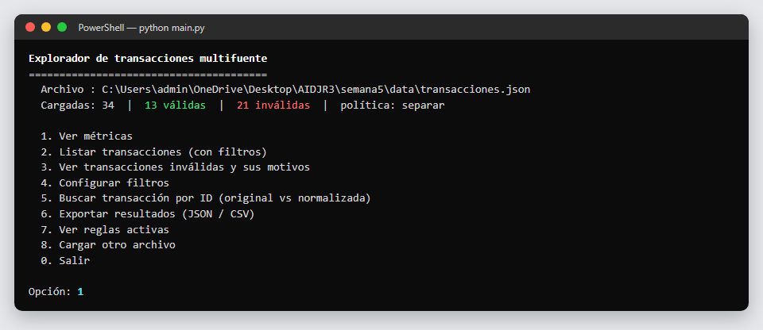</p>

- Tablas **paginadas** (`[s]iguiente`, `[a]nterior`, `[d]etalle #`).
- Filtros **combinables**: fuente, estado, moneda, rango de fechas, rango de montos, texto libre y ordenamiento.
- Gráfico de barras por estado y colores ANSI (se desactivan con `NO_COLOR=1`).
- Exportación a la carpeta `salida/`.

<details open>
<summary><b>📸 Capturas de la CLI</b></summary>

#### Métricas
Conteo por estado con barras, totales por moneda desglosados por estado, conteo por fuente y motivos de invalidez.

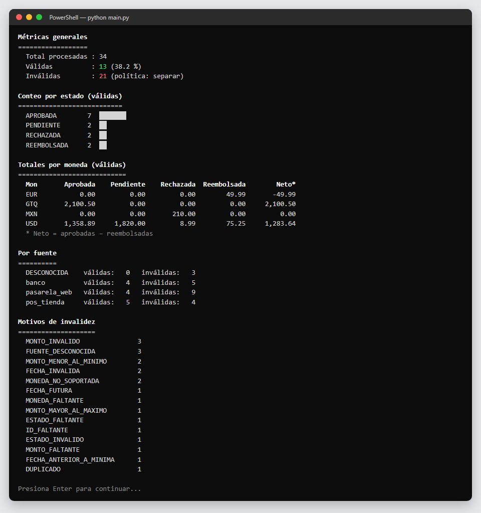

#### Transacciones inválidas
Cada registro inválido se muestra en rojo con sus códigos de error debajo. La tabla está paginada.

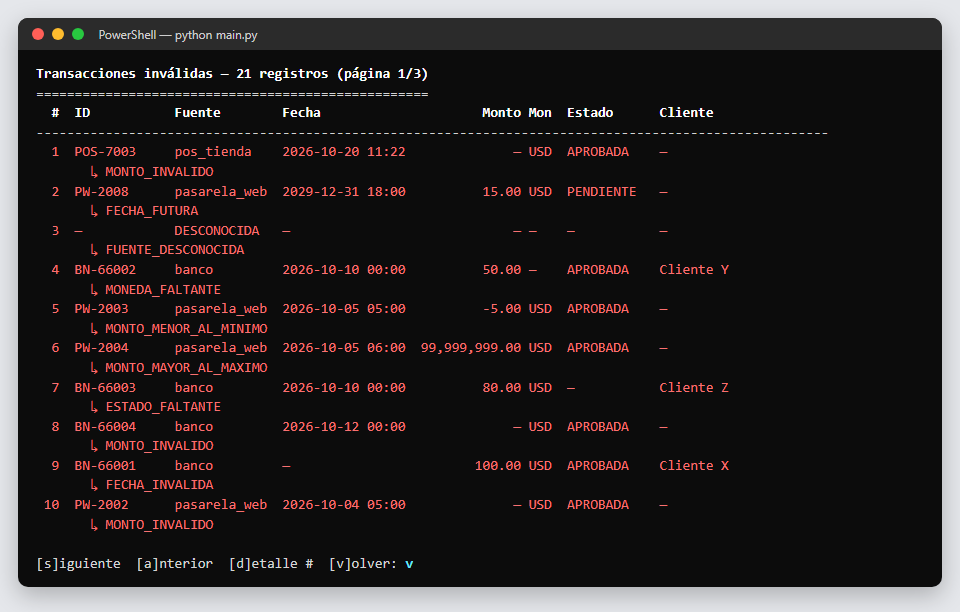

#### Filtros y listado filtrado
Filtro por moneda `USD` y orden por monto descendente: coinciden 10 de 13 transacciones válidas.

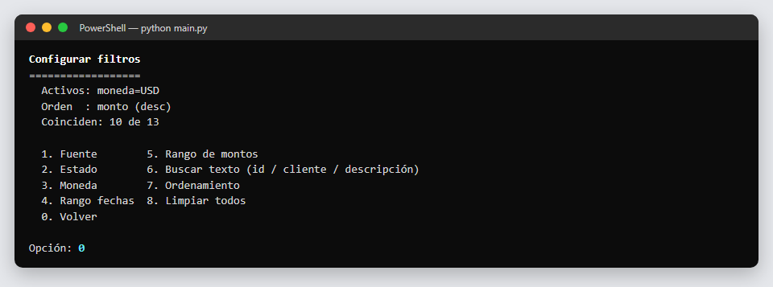
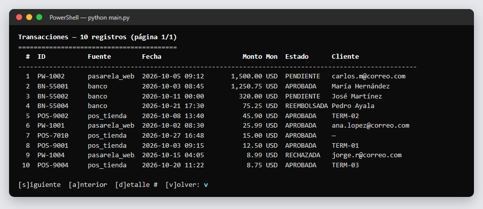

#### Detalle: registro original vs. normalizado
Búsqueda por ID. Se ve por qué la transacción es inválida y qué nota dejó el normalizador.

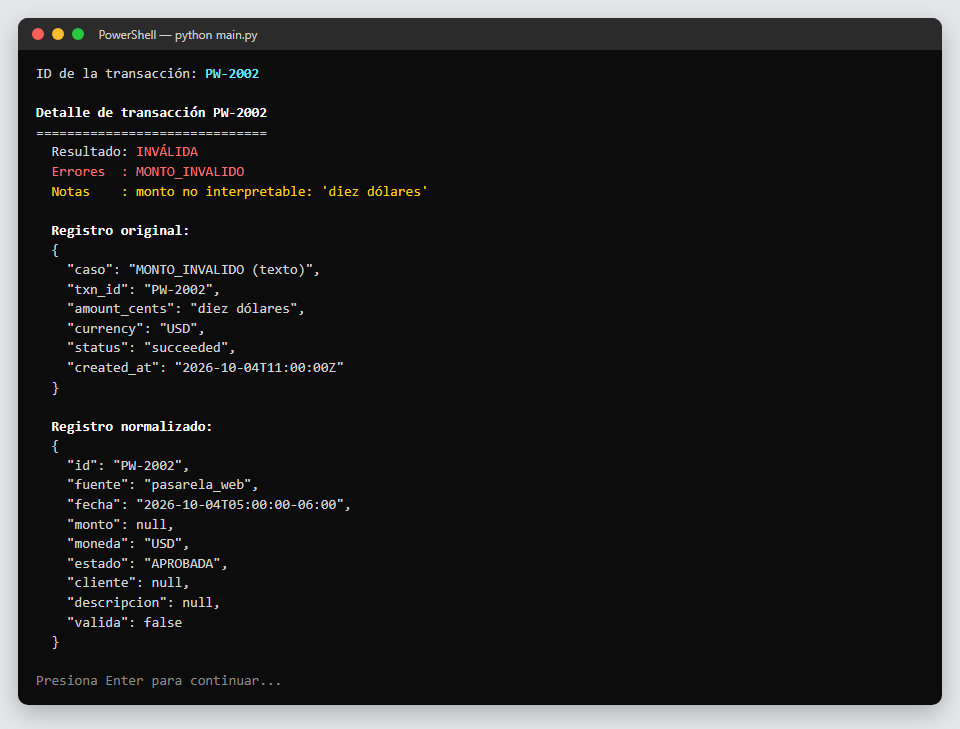

</details>

### 2. Interfaz web — `python web.py`

| Página | Contenido |
|---|---|
| **Métricas** (`/`) | Tarjetas con KPI, barras por estado, tablas por fuente y moneda, motivos de invalidez. **Todo es clicable** y abre el listado ya filtrado. |
| **Transacciones** | Formulario de filtros, tabla paginada y enlace al detalle |
| **Inválidas** | Mismo listado, con los códigos de error como etiquetas |
| **Detalle** | Registro **original** y **normalizado** lado a lado, más las notas de normalización |
| **Reglas** | Vista legible de todo `reglas.json` |
| Barra superior | Búsqueda por ID, **carga de JSON** desde el navegador, descarga en **JSON / CSV** |

Los estilos son propios y no usan CDN, así que funciona sin conexión a internet.

<details open>
<summary><b>📸 Capturas de la interfaz web</b></summary>

#### Panel de métricas
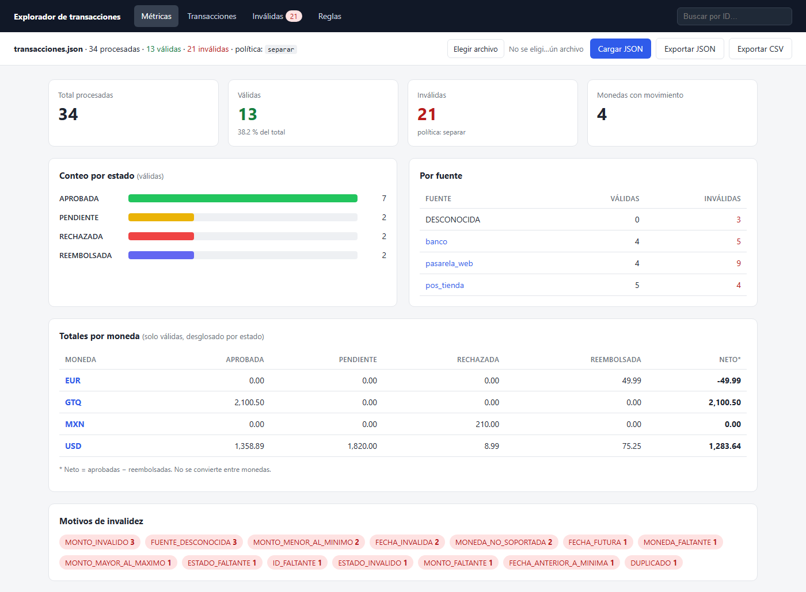

#### Listado con filtros
Moneda `USD`, ordenado por monto descendente. Los estados se distinguen por color.

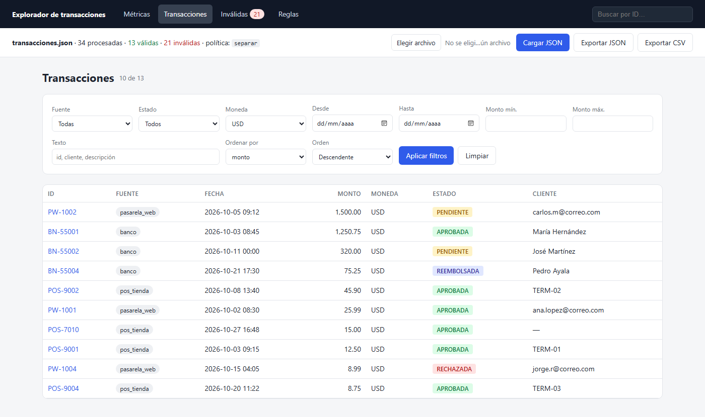

#### Transacciones inválidas
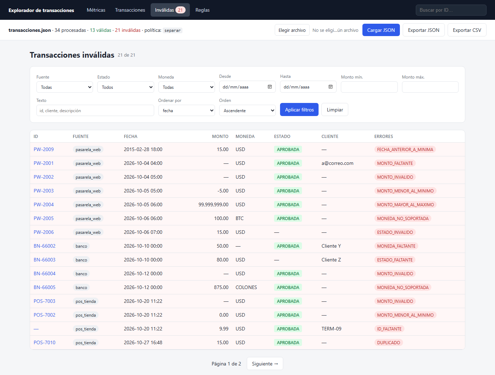

#### Detalle: original vs. normalizado
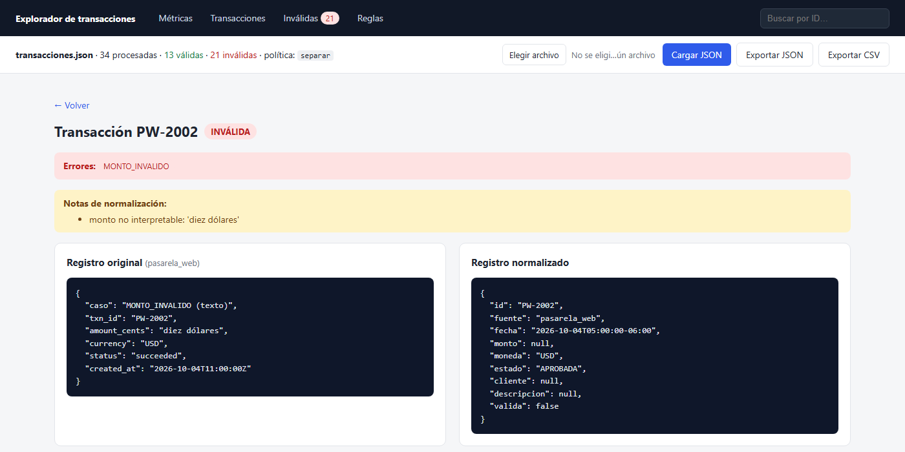

#### Reglas activas
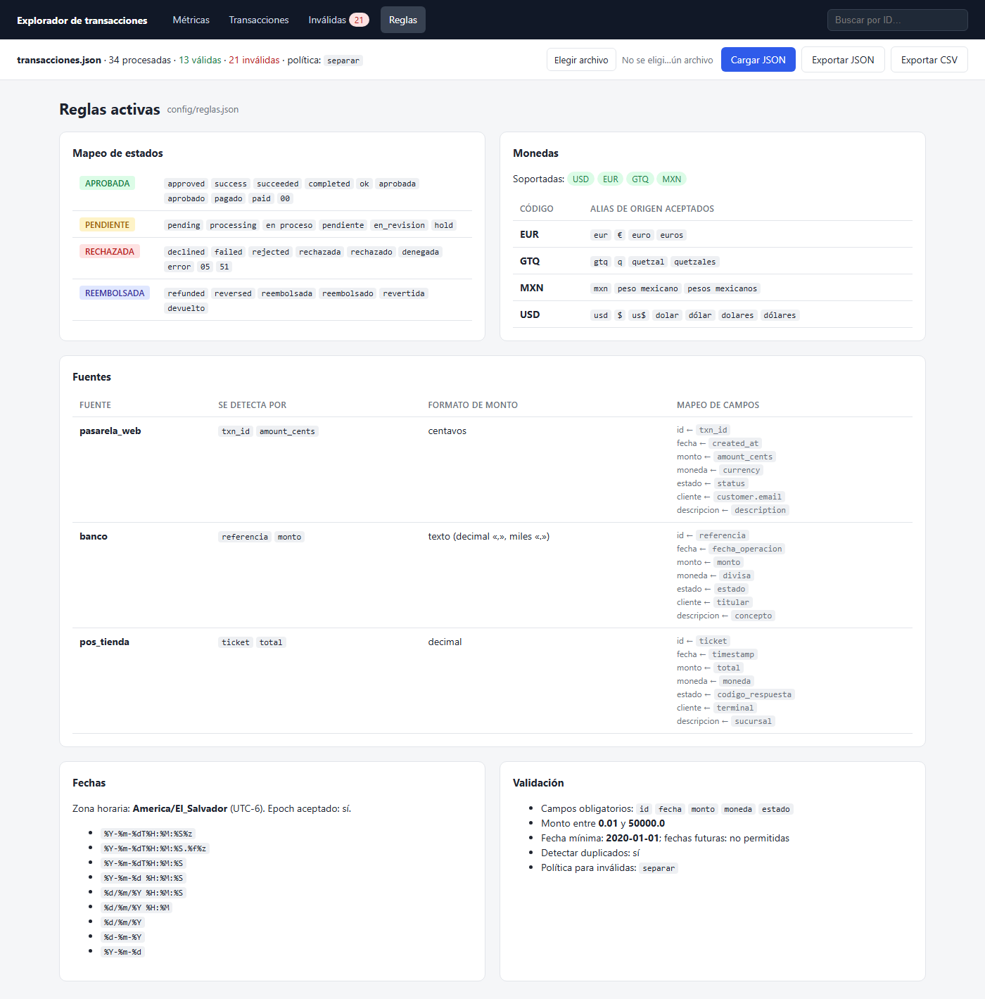

</details>

---

## 🧪 Datos de prueba

| Archivo | Registros | Propósito |
|---|---|---|
| [`data/datos_validos.json`](data/datos_validos.json) | 12 | 4 por fuente, con todas las variantes de formato. **Todos deben ser válidos.** |
| [`data/datos_inconsistentes.json`](data/datos_inconsistentes.json) | 22 | Cada registro documenta en `"caso"` el error que **debe** detectarse |
| [`data/transacciones.json`](data/transacciones.json) | 34 | Mezcla de los dos anteriores (archivo por defecto) |

**Casos inconsistentes cubiertos:** monto nulo, en texto, negativo, cero, booleano, excesivo o con
formato mixto · moneda vacía, `BTC` o `Colones` · estado ausente o sin mapeo · fecha futura, muy
antigua, con formato desconocido o inexistente (31 de febrero) · id vacío · fuente desconocida ·
elemento que no es un objeto · duplicado.

---

## ✔️ Pruebas automáticas

```bash
python -m unittest discover -s tests -t . -v
```

| Prueba | Verifica |
|---|---|
| `test_detecta_fuentes` | Detección correcta de las 3 fuentes y de la fuente desconocida |
| `test_centavos_a_unidades` | Centavos → unidades, alias de moneda, mapeo de estado y conversión UTC → UTC-6 |
| `test_monto_texto_formato_local` | `"Q 2.100,50"` → `2100.50 GTQ` |
| `test_epoch_y_codigo_estado` | Epoch en texto y código de estado `05` → `RECHAZADA` |
| `test_archivo_valido_sin_errores` | Ningún registro válido se rechaza (sin falsos positivos) |
| `test_cada_caso_inconsistente_detecta_su_error` | **Cada** caso inconsistente produce **su** código esperado |
| `test_metricas` | Los totales por moneda y estado son exactos |

---

## 🧩 Cómo extender el sistema

**Agregar una fuente nueva** (por ejemplo, una billetera móvil) sin escribir código:

```json
"billetera": {
  "detectar_por": ["wallet_tx", "importe"],
  "campos": { "id": "wallet_tx", "fecha": "fecha", "monto": "importe",
              "moneda": "moneda", "estado": "resultado", "cliente": "telefono" },
  "formato_monto": "decimal"
}
```

**Otros cambios que solo requieren editar `reglas.json`:**

- Aceptar una moneda nueva: agregarla a `monedas_soportadas` y a `alias_moneda`.
- Aceptar un estado nuevo: agregar el valor a la lista correspondiente de `mapeo_estados`.
- Cambiar los límites de monto, la fecha mínima o la política para inválidas: editar `validacion`
  o `politica_invalidas`.

---

## 🤖 Uso de IA

Se usó **Claude** como asistente de código, de acuerdo con las condiciones de la actividad:

| La IA se usó para | Revisión y decisión del estudiante |
|---|---|
| Proponer la estructura de módulos | Aprobé la separación en normalización, validación, métricas e interfaz |
| Escribir la lógica de parsing de montos y fechas | Verifiqué el comportamiento con las pruebas y los datos inconsistentes |
| Proponer una primera versión de las reglas | Revisé cada criterio y decidí mantener el **monto máximo de 50,000**, **rechazar BTC y colones** y la política **`separar`** |
| Construir la CLI y la interfaz web | Elegí Flask en lugar de Streamlit por compatibilidad con Python 3.15 |
| Generar datos de prueba y pruebas unitarias | Las pruebas detectaron errores que se corrigieron (ver la nota técnica) |

Las reglas están en [`config/reglas.json`](config/reglas.json), con la justificación de cada
decisión en sus comentarios. La nota técnica ([`.docx`](NOTA_TECNICA.docx) · [`.md`](NOTA_TECNICA.md))
documenta los **ajustes hechos a las sugerencias de la IA**. Por ejemplo, se corrigió la detección
de fuentes, que clasificaba como desconocidos los registros con campos `null`; el error salió a la
luz en las pruebas automáticas.

---

## 📁 Estructura del proyecto

```text
semana5/
├── main.py                     # Entrada: CLI interactiva
├── web.py                      # Entrada: interfaz web (Flask)
├── requirements.txt            # Solo Flask (para la web)
├── NOTA_TECNICA.md             # Decisiones de diseño y uso de IA
├── NOTA_TECNICA.docx           # Misma nota en formato Word (entregable, 1 página)
│
├── docs/capturas/              # Capturas de pantalla usadas en este README
│
├── config/
│   └── reglas.json             # ⚙️ Reglas: fuentes, monedas, estados, fechas, validación
│
├── src/
│   ├── modelo.py               # Esquema normalizado (Transaccion)
│   ├── configuracion.py        # Carga de reglas
│   ├── normalizador.py         # Detección de fuente y conversión de campos
│   ├── validador.py            # Criterios de validez y duplicados
│   ├── procesador.py           # Pipeline y política para inválidas
│   ├── metricas.py             # Cálculo de métricas
│   ├── filtros.py              # Filtros y ordenamiento
│   ├── interfaz_cli.py         # Presentación: consola
│   └── interfaz_web.py         # Presentación: web
│
├── templates/                  # Vistas HTML (Jinja2)
├── static/estilos.css          # Estilos de la web
├── data/                       # Datos de prueba
└── tests/test_sistema.py       # Pruebas unitarias
```

---

<p align="center">
  <b>Rafael Edgardo Arévalo</b> · AI for Developers Jr. · Kodigo El Salvador · 2026
</p>
